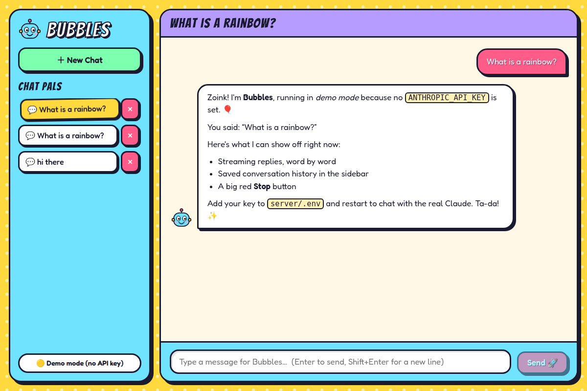

# 🎈 Bubbles — Cartoon AI Chatbot



A small full-stack chatbot with a **streaming chat UI** and **saved conversation history**, wrapped in a bouncy cartoon theme.

- **Frontend:** React 18 + Vite (no UI library — all hand-written CSS)
- **Backend:** Node.js + Express, talking to Claude through the official `@anthropic-ai/sdk`
- **Streaming:** the server forwards Claude's tokens as Server-Sent Events; the React app reads them live from a `fetch` stream
- **History:** conversations are saved to `server/data/conversations.json` and listed in the sidebar

> No API key? No problem — the app starts in **demo mode** with canned (still streamed) replies so you can try the whole UI offline.

## Features

- Live token-by-token replies with a blinking cursor and a "thinking" animation
- **Stop** button that cancels generation (the partial reply is kept)
- Conversation history sidebar: create, switch, delete; titles come from your first message
- Markdown rendering (lists, code blocks, links) in bot replies
- Responsive layout (sidebar becomes a drawer on phones)
- Friendly error bubbles (bad key, rate limit, network)

## Quick start

**Requirements:** Node.js **18.11+** (Node 20 recommended — `nvm use` reads `.nvmrc`).

**Fastest:** `./run.sh` — picks a suitable Node, installs on first run, builds and serves at **http://localhost:3001**.

**Development mode** (hot reload on http://localhost:5173):

```bash
cd cartoon-ai-chatbot
nvm use            # optional, picks Node 20
npm run setup      # installs root, server and client dependencies
npm run dev        # starts API (3001) and web app (5173) together
```

Open **http://localhost:5173** 🎉

### Use the real Claude

```bash
cp server/.env.example server/.env
# edit server/.env and set ANTHROPIC_API_KEY=sk-ant-...
npm run dev
```

The sidebar badge shows **🟢 Live: Claude** when a key is detected, or **🟡 Demo mode** otherwise.

| Variable | Default | Purpose |
|---|---|---|
| `ANTHROPIC_API_KEY` | _(empty → demo mode)_ | Your Anthropic API key |
| `CLAUDE_MODEL` | `claude-opus-5-5` | Model used for replies (e.g. `claude-haiku-5-5` for a cheaper/faster bot) |
| `CLAUDE_EFFORT` | `low` | `low` / `medium` / `high` — how hard the model thinks before answering |
| `PORT` | `3001` | API port |

### Production-style run

```bash
npm start   # builds the client, then serves everything from http://localhost:3001
```

### Tests

```bash
npm test    # server API + SSE streaming tests (Node's built-in test runner, demo mode)
```

## How streaming works

```
Browser ──POST /api/conversations/:id/messages──▶ Express ──messages.stream()──▶ Claude
   ▲                                                  │
   └──── SSE:  start → token → token → … → done ◀─────┘
```

1. The browser POSTs the user's message. The server saves it and replies with `text/event-stream`.
2. For each text delta from Claude the server writes an SSE `token` event.
3. `client/src/api.js` parses the frames from `response.body.getReader()` and appends each token to the bubble.
4. When you press **Stop** (or close the tab) the connection closes; the server aborts the upstream Claude request and saves what was generated so far.

## API

| Method | Path | Description |
|---|---|---|
| GET | `/api/health` | `{ ok, mode: "claude" \| "demo", model }` |
| GET | `/api/conversations` | List conversations (newest first) |
| POST | `/api/conversations` | Create a conversation |
| GET | `/api/conversations/:id` | Conversation with all messages |
| PATCH | `/api/conversations/:id` | Rename (`{ title }`) |
| DELETE | `/api/conversations/:id` | Delete |
| POST | `/api/conversations/:id/messages` | Send `{ content }`, receive an SSE stream |

## Project layout

```
cartoon-ai-chatbot/
├── run.sh                # one-command launcher
├── docs/screenshot.png
├── package.json          # root scripts (setup / dev / build / start / test)
├── server/
│   ├── index.js          # entry point
│   ├── app.js            # Express routes + SSE endpoint
│   ├── llm.js            # Claude streaming + offline demo mode
│   ├── store.js          # JSON-file conversation store
│   └── server.test.js
└── client/
    ├── vite.config.js    # dev proxy: /api → :3001
    └── src/
        ├── App.jsx       # state: conversations, messages, streaming/stop
        ├── api.js        # REST helpers + SSE stream reader
        ├── styles.css    # the cartoon theme
        └── components/   # Sidebar, MessageBubble, Composer, Mascot (SVG robot)
```

## Ideas for next steps

- Swap the JSON file for SQLite/Postgres and add user accounts
- Let users rename conversations in the UI (the `PATCH` endpoint already exists)
- Add the server-side `fallbacks` option for refusal handling, prompt caching for long chats, or tool use
