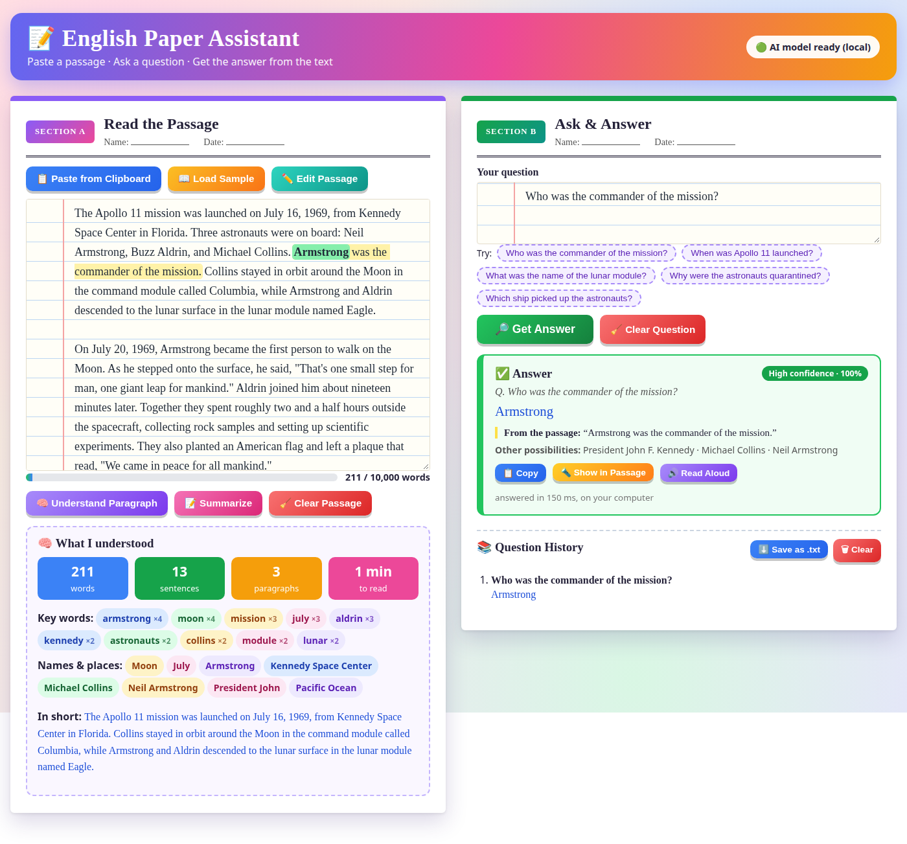

# 📝 English Paper Assistant



> A small full-stack project: paste an English passage, ask a question, and get the answer
> highlighted in the text — running **100% locally**, no API key needed.

Paste an English paragraph (**up to 10,000 words**), click **Understand**, then ask any question about it.
The app answers from the text and highlights the exact answer in the passage.

* **UI** – React 19 + Vite, styled like a colourful lined English exam paper
* **Backend** – Node.js + Express
* **AI** – a small question-answering model (DistilBERT-SQuAD via `@huggingface/transformers`) that runs **on your computer**.
  No API key, no cloud calls while you use it. The model (~65 MB) is downloaded **once** on the first run and cached in `server/models/`.

## Run it

```bash
cd english-paper-assistant
./run.sh
```

Then open **http://localhost:3001**. On the very first run `run.sh` installs the packages and downloads the model
(the page shows a progress pill until it says "AI model ready"). Later runs start in a few seconds.

Prefer npm commands?

```bash
npm install     # first time only (Node.js 20.19+ or 22+ required; .nvmrc says 22)
npm start       # builds the React app and starts the server on port 3001
```

Developer mode with hot reload: `npm run dev` (UI on http://localhost:5173, API on 3001).
Self-test of the answering engine: `cd server && node test.js`.

## Buttons

| Where | Button | What it does |
|---|---|---|
| Passage | 📋 Paste from Clipboard | Pastes your clipboard into the passage box (or just press Ctrl+V in the box) |
| Passage | 📖 Load Sample | Loads an example passage plus clickable sample questions |
| Passage | 🔍 Reading View / ✏️ Edit Passage | Switches between the editable box and a read-only view that shows highlights |
| Passage | 🧠 Understand Paragraph | Word/sentence counts, key words, names & places, short summary |
| Passage | 📝 Summarize | Summary of the whole passage |
| Passage | 🧹 Clear Passage | Empties the passage |
| Question | 🔎 Get Answer (or Ctrl+Enter) | Finds the answer in the passage |
| Question | 🧹 Clear Question | Empties the question box |
| Answer | 📋 Copy · 🔦 Show in Passage · 🔊 Read Aloud | Copy the answer, highlight it in the passage, speak it |
| History | ⬇️ Save as .txt · 🗑 Clear | Download all questions & answers, or clear the list |

## How it answers

1. The passage is split into sentences and overlapping chunks (so 10,000 words are never fed to the model at once).
2. Chunks and sentences are ranked against your question (BM25 keyword search).
3. The AI model reads the best chunks and tight sentence windows and extracts the exact answer span.
4. Candidates are re-ranked by how well their sentence matches your question; the best one is shown with a
   confidence level, the supporting sentence, and other possibilities.

**Good to know**
* Answers are *extracted* from your text, so the app does not make things up. If the passage has no answer,
  you get a low-confidence warning rather than a confident guess.
* It is best at who / what / when / where / which / how many / why questions with a factual answer in the text.
* **Yes/No** questions: the app shows the closest sentence from the passage instead of guessing yes or no.
* "What is this about?" / "Summarize" style questions return a summary.
* Questions that need maths or combining facts from far-apart places can be wrong — check the highlighted sentence.

## Troubleshooting

* **"Model problem" / download fails** – the first run needs internet to fetch the model. On a corporate network
  with a TLS-inspecting proxy, `run.sh` already tells Node to trust your OS certificate store (needs Node 22.15+;
  otherwise set `NODE_EXTRA_CA_CERTS=/path/to/company-ca.pem`).
* **Port already in use** – `PORT=3002 ./run.sh`
* **Better (bigger) model** – `QA_MODEL=Xenova/bert-large-uncased-whole-word-masking-finetuned-squad ./run.sh`
  (slower and a much larger download).
